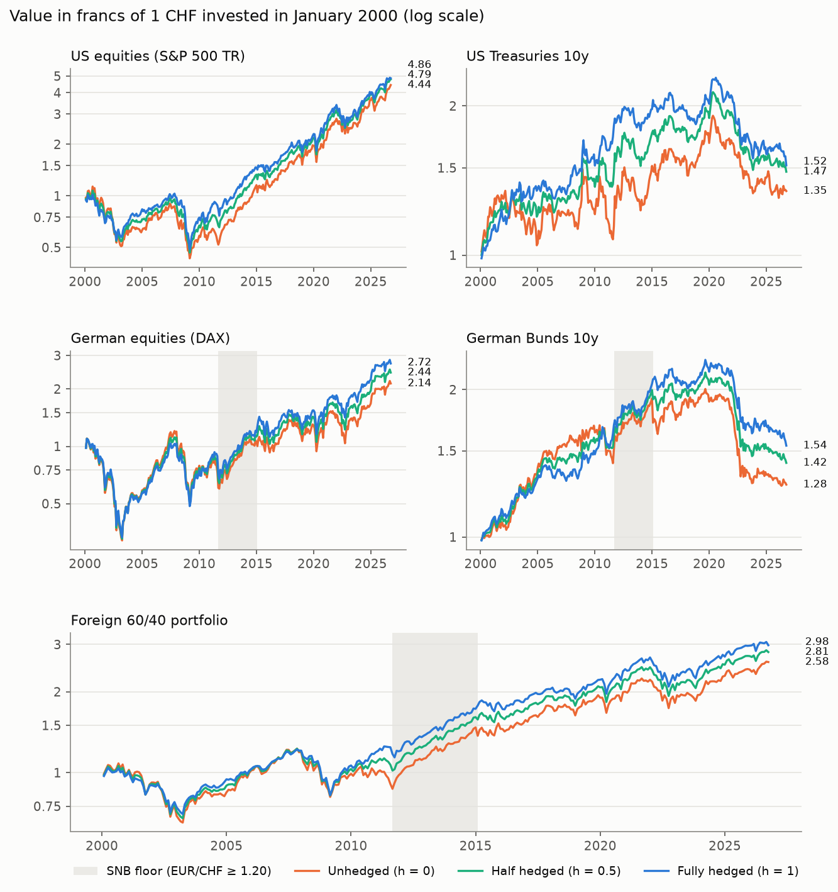
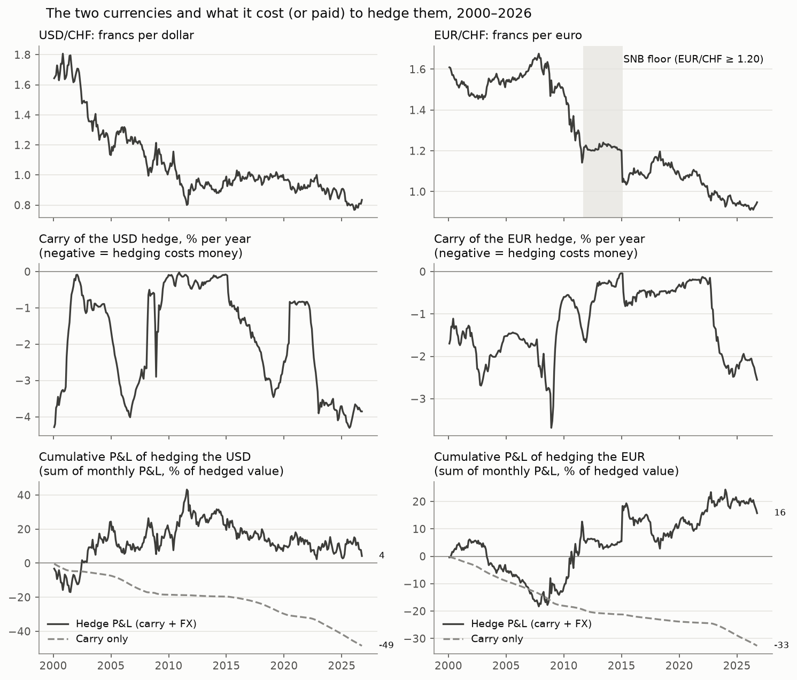
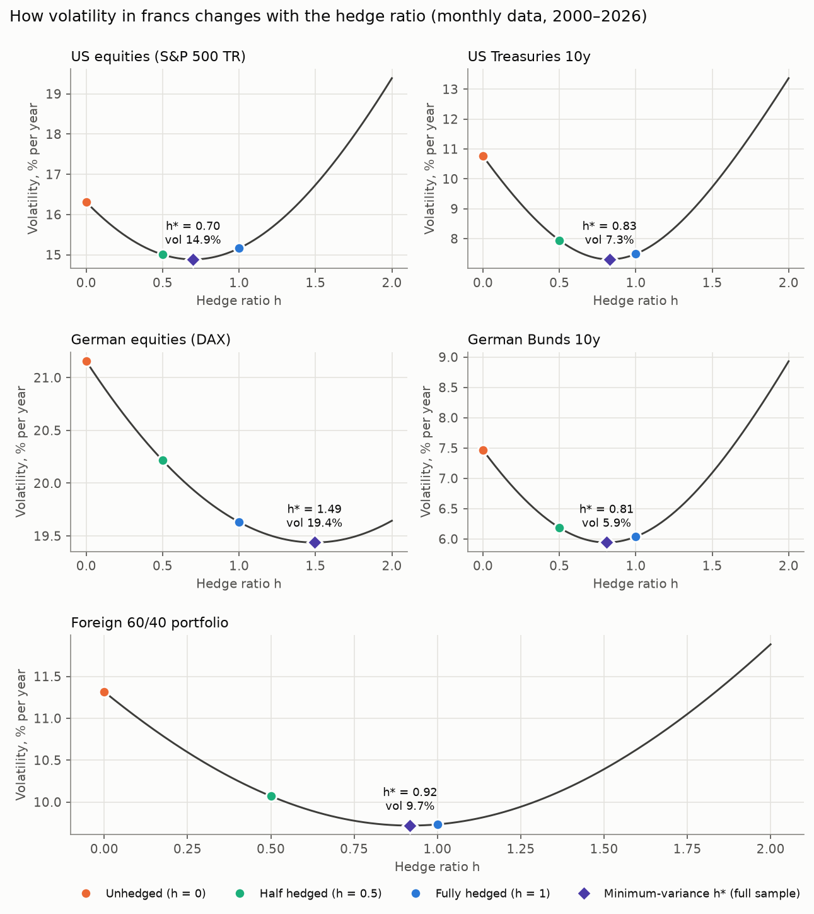
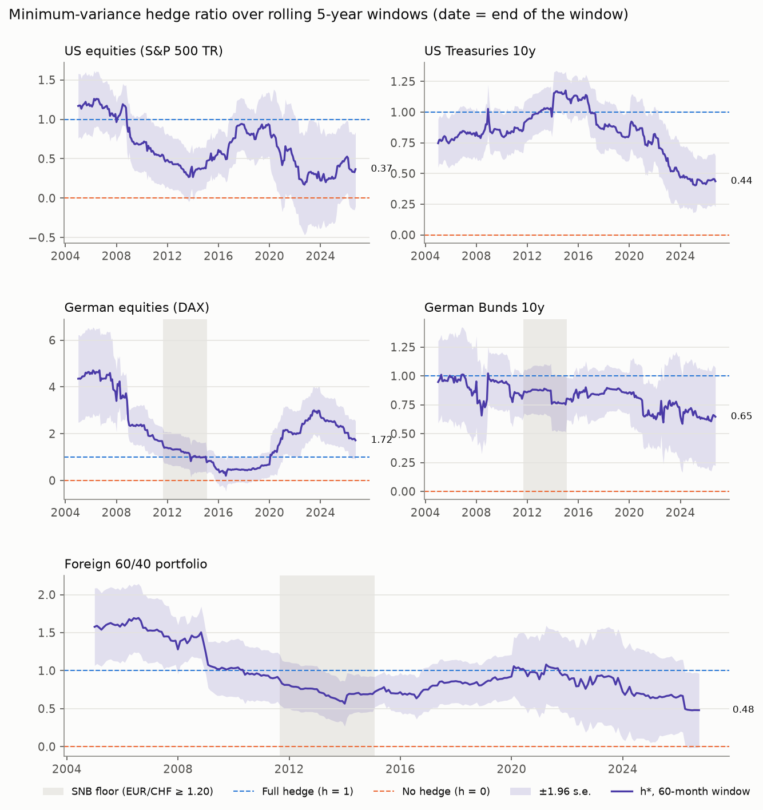
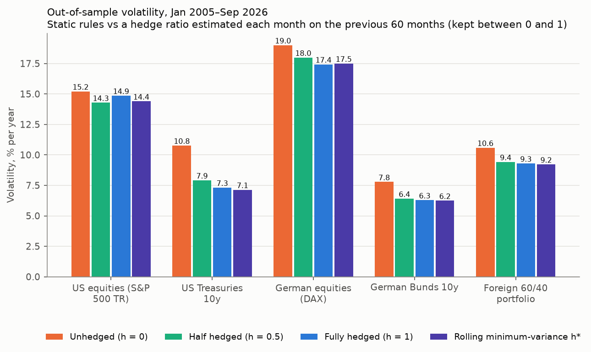
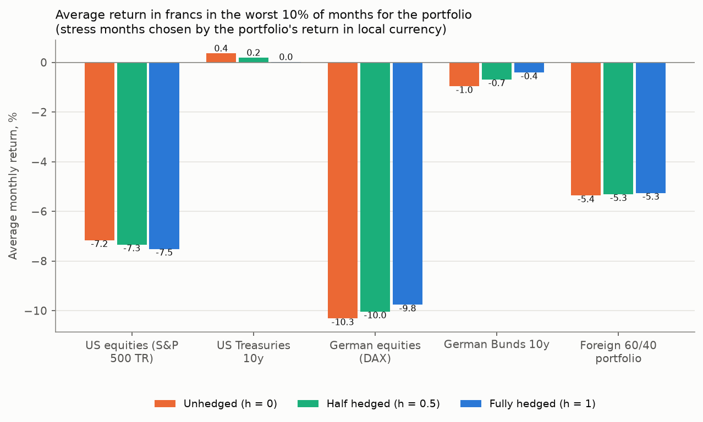

# Should a Swiss-Franc Investor Hedge the Dollar and the Euro?

**Cost, benefit and the optimal hedge ratio for US and German stocks and bonds, 2000–2026**

A Swiss pension fund or private client that buys US or German assets carries two risks:
the asset itself and the currency. This project uses 26 years of monthly data to measure
what hedging the currency back into francs with 1-month forwards did to risk and return,
what it cost, and how much of the exposure it is best to hedge.

Every number below is produced by `python run_all.py` and can be found in
[`results/summary.md`](results/summary.md).

---

## The short answer

| Question | Answer (monthly data, January 2000 – September 2026) |
|---|---|
| Does hedging reduce risk? | **Yes, above all for bonds.** Annualised volatility in francs falls from 10.8% to 7.5% for US Treasuries, from 7.5% to 6.0% for German Bunds and from 11.3% to 9.7% for a foreign 60/40 portfolio. For equities the gain is small: 16.3% → 15.2% (US) and 21.2% → 19.6% (Germany). |
| What did it cost? | **About nothing, on average.** The interest-rate carry cost 1.8% a year on the dollar and 1.2% on the euro, but the franc appreciated by 2.0% and 1.8% a year, which the hedge earned back. Net hedge P&L: +0.2% (USD) and +0.6% (EUR) a year, not significantly different from zero (p = 0.923 and 0.553). |
| How much should you hedge? | **Bonds about 80%** (h\* = 0.83 US, 0.81 Germany). **US equities 70%**: the dollar tends to rise against the franc when US stocks fall. **German equities 149%**: the euro tends to fall against the franc when German stocks fall. **The portfolio 92%**, not significantly different from a full hedge (p = 0.413). |
| Is the answer stable? | **No.** In 2022–26 the portfolio's h\* is 0.50 [0.05, 0.96], and the 5-year estimate ending September 2026 is 0.48. |
| Does estimating h\* beat a simple rule? | **Barely.** Out of sample (January 2005 – September 2026) the portfolio's volatility is 10.6% unhedged, 9.4% half hedged, 9.3% fully hedged and 9.2% with a hedge ratio re-estimated every month. |
| What does a hedge cost today? | With the rates of August 2026 (CHF −0.04%, USD 3.82%, EUR 2.51%): **3.85% a year for the dollar and 2.55% for the euro**, 2.12 and 2.09 times their 2000–2026 averages (1.8% and 1.2%). |

**Bottom line.** For a Swiss investor, hedging foreign bonds removed a large part of their
risk at no net cost over 2000–2026, because the franc appreciated by roughly as much as
the interest-rate gap. For equities the decision matters much less, and the direction
depends on the currency: the dollar has been a partial natural hedge, the euro has not.
Today the carry is much more expensive than its long-run average, so a hedge only pays for
itself if the franc keeps appreciating at that pace, and that is not something the past
can guarantee.

---

## Contents

1. [Data](#1-data)
2. [Method](#2-method)
3. [Results](#3-results)
4. [Robustness](#4-robustness)
5. [Limitations](#5-limitations)
6. [How to reproduce](#6-how-to-reproduce)
7. [Repository structure](#7-repository-structure)
8. [References](#8-references)

---

## 1. Data

All series are downloaded by the code and cached in `data/raw/` together with
`manifest.json`, which records the source, URL, first/last date and download time of each
one (downloaded on 2026-10-09). Once the cache exists the project runs offline.

| Series | Source | Used for | Coverage in the cache |
|---|---|---|---|
| EUR/CHF, EUR/USD (reference rates, daily) | ECB | currency returns; USD/CHF = EUR/CHF ÷ EUR/USD | 1999-01-04 – 2026-10-09 |
| USD/CHF (H.10, noon New York) | FRED `DEXSZUS` | robustness check only | 1971-01-04 – 2026-10-02 |
| S&P 500 Total Return | Yahoo `^SP500TR` | US equities | 1999-01-04 – 2026-10-09 |
| S&P 500 price index | Yahoo `^GSPC` | data check only (dividends) | 1999-01-04 – 2026-10-09 |
| DAX (performance index) | Yahoo `^GDAXI` | German equities | 1999-01-04 – 2026-10-09 |
| US Treasury 10-year yield | FRED `DGS10` | US bond returns | 1962-01-02 – 2026-10-07 |
| German 10-year yield (Svensson curve) | Bundesbank | German bond returns | 1997-08-07 – 2026-10-09 |
| 3-month rates CHF, USD (OECD) | FRED `IR3TIB01CHM156N`, `IR3TIB01USM156N` | carry, CHF risk-free rate | 1999-07-01 / 1964-06-01 – 2026-08-01 |
| Euribor 3-month | ECB | carry | 1994-01-01 – 2026-09-01 |
| Bond ETFs IEF, EXHD.DE (adjusted close) | Yahoo | data check only | 2002-07-30 / 2008-01-02 – 2026-10-09 |

**Data decisions** (each one tested; the checks are in Step 0 of `run_all.py`):

- **Exchange rates from one source.** EUR/CHF and EUR/USD come from the same ECB fixing
  (14:15 CET), so the cross rate USD/CHF is internally consistent. Against the Fed's
  USD/CHF series (noon New York) the monthly returns correlate 0.9789, with a mean absolute
  difference of 0.44% (Table 0c). Swapping the source changes nothing material (Section 4).
- **Equities include dividends.** The S&P 500 Total Return index grew 8.32% a year against
  6.36% for the price index, a gap of 1.96% that matches a dividend yield (Table 0d).
  The Euro Stoxx 50 total-return history is behind a login on the STOXX website
  (HTTP 403 when tested), so euro equities are represented by the DAX, which Deutsche
  Börse calculates as a performance index (dividends reinvested).
- **Bond returns are built from yields**, because free total-return indices for 10-year
  government bonds were not available for the whole sample (formula in Section 2). They are
  validated against bond ETFs: the monthly correlation is 0.990 with IEF (US 7–10y) and 0.920
  with EXHD.DE (Germany 5.5–10.5y) (Table 0b). This check caught an error during
  development: the first German ETF ticker used belonged to the 2.5–5.5-year fund.
- **Short rates are monthly 3-month rates.** One month is missing in the OECD US series
  (April 2020); it is filled with the previous month's value (Table 0f).
- **No forward prices.** FX forward points were not available from the free sources used
  here, so the forward is priced from the interest-rate gap (covered interest parity,
  Section 2).
- **The SNB minimum rate (EUR/CHF ≥ 1.20, Sep 2011 – Jan 2015) stays in the sample.** It is
  what an investor actually lived through, and its removal in January 2015 is exactly the
  kind of shock a hedge is for. Section 4 repeats the analysis without those months.

The raw CSV files are **not** committed (`.gitignore`), because redistribution of provider
data may be restricted; `manifest.json` is committed so anyone can see exactly what was
downloaded and re-create it with `python run_all.py`.

---

## 2. Method

### Conventions

All returns are **simple monthly returns in decimals** (they can be added across a
portfolio). For each foreign asset:

| Symbol | Meaning |
|---|---|
| $r^{\text{local}}$ | return of the asset in its own currency (USD or EUR) |
| $r^{\text{fx}}$ | change in the franc price of one dollar or euro. **A positive value means the foreign currency rose against the franc** (good for an unhedged Swiss investor) |
| $f$ | forward premium of selling the foreign currency forward for one month. It is negative when Swiss rates are lower, which is the **carry cost** of hedging |

The forward premium comes from covered interest parity, with $i$ the 3-month interest rate
of each currency, per year:

```math
f = \frac{1 + i_{\text{CHF}}/12}{1 + i_{\text{foreign}}/12} - 1
```

Rates are those of the **previous month**, so a hedge only uses information available when
it is put on.

### The hedging arithmetic (`hedging/hedging.py`)

```math
\begin{aligned}
R_U &= (1 + r^{\text{local}})\,(1 + r^{\text{fx}}) - 1 \\
H &= f - r^{\text{fx}} \\
R(h) &= R_U + h\,H
\end{aligned}
```

$R_U$ is the unhedged return in francs. $H$ is the profit of the forward hedge per franc
invested: it gains when the foreign currency falls, and it pays the carry. $R(h)$ is the
return with a hedge ratio $h$, from $h = 0$ (unhedged) to $h = 1$ (fully hedged). The
forward sells, at the start of each month, an amount of foreign currency equal to the value
of the position.

The **minimum-variance hedge ratio** is the $h$ that minimises the variance of $R(h)$:

```math
h^{*} = \arg\min_{h}\ \mathrm{Var}(R_U + h\,H) = \frac{\mathrm{Cov}(R_U,\ -H)}{\mathrm{Var}(H)}
```

It is the slope of an OLS regression of $R_U$ on $r^{\text{fx}} - f$, and the R² of that
regression is the share of the variance that the best hedge removes. h\* < 1 means the
currency already offsets part of the asset's risk; h\* > 1 means the currency adds to it.
Standard errors are Newey-West (robust to heteroskedasticity and autocorrelation) with
$\lfloor 4 (T/100)^{2/9} \rfloor$ lags, where $T$ is the number of months.

### Bond returns from yields (`hedging/data_prep.py`)

Each month we buy a 10-year bond at par (coupon = current yield $y_0$). One month later it
has $n = 10 - 1/12$ years left and is priced at the new yield $y_1$:

```math
P = \frac{y_0}{y_1}\left(1 - (1 + y_1)^{-n}\right) + (1 + y_1)^{-n}, \qquad r^{\text{local}} = \frac{y_0}{12} + P - 1
```

It works with the zero and negative yields of 2015–2021.

### Portfolio and performance

The example **foreign 60/40 portfolio** holds 30% S&P 500, 30% DAX, 20% US Treasuries and
20% Bunds, rebalanced every month, with the same hedge ratio on every asset.
Performance statistics: compound annual return (CAGR), annualised volatility, Sharpe ratio
in excess of the CHF 3-month rate, maximum drawdown and worst month.

### Steps (`run_all.py`)

| Step | What it does | Output |
|---|---|---|
| 0 | Data checks: coverage, bond returns vs ETFs, two USD/CHF sources, dividends, largest moves, missing rates | Tables 0a–0f |
| 1 | Volatility of the asset, of the currency, and their correlation | Table 1 |
| 2 | Performance at h = 0, 0.5, 1 | Table 2, Figure 2 |
| 3 | Cost of hedging: carry, currency return and hedge P&L, by subperiod | Table 3, Figure 1 |
| 4 | Minimum-variance hedge ratio: full sample, subperiods, rolling 60 months | Tables 4a–4c, Figures 3–4 |
| 5 | Out of sample: static rules vs an h\* re-estimated each month on the past 60 months only, capped between 0 and 1 | Table 5, Figure 6 |
| 6 | Stress months: does the currency help or hurt when markets fall? | Tables 6a–6d, Figure 5 |
| 7 | Robustness: Fed USD/CHF, quarterly horizon, without the SNB floor | Table 7 |

---

## 3. Results

### 3.1 Where the risk comes from

| Asset | Volatility in its currency | Volatility of the currency | Correlation between the two | Volatility in francs, unhedged | Hedged | Change |
|---|---|---|---|---|---|---|
| US equities (S&P 500 TR) | 15.2% | 9.5% | -0.19 | 16.3% | 15.2% | -7.0% |
| US Treasuries 10y | 7.5% | 9.5% | -0.23 | 10.8% | 7.5% | -30.4% |
| German equities (DAX) | 19.7% | 5.6% | 0.14 | 21.2% | 19.6% | -7.2% |
| German Bunds 10y | 6.1% | 5.6% | -0.19 | 7.5% | 6.0% | -19.1% |
| Foreign 60/40 portfolio | 9.7% | 6.3% | -0.05 | 11.3% | 9.7% | -14.0% |

*Table 1. Annualised volatilities; "hedged" = h = 1.*

- For **US Treasuries the dollar is riskier than the bond itself** (9.5% vs 7.5%), so
  hedging cuts volatility by 30.4%. For Bunds the euro is almost as volatile as the bond
  (5.6% vs 6.1%) and hedging cuts volatility by 19.1%.
- For **equities the currency is small next to the asset's own risk** (15.2% and 19.7%),
  so hedging only cuts volatility by about 7%.
- The **sign of the correlation** decides the rest. US stocks and the dollar move in
  opposite directions (−0.19): when US stocks fall, the dollar tends to rise against the
  franc, which cushions the loss. The DAX and the euro move together (+0.14): when German
  stocks fall, the euro tends to fall against the franc too, which makes the loss worse.

### 3.2 Performance with and without a hedge

| Asset | Hedge | Return per year | Volatility | Sharpe ratio | Worst drawdown | Worst month | When |
|---|---|---|---|---|---|---|---|
| US equities (S&P 500 TR) | h = 0 | 5.7% | 16.3% | 0.40 | -61.9% | -13.1% | 2008-10 |
| US equities (S&P 500 TR) | h = 1 | 6.1% | 15.2% | 0.44 | -52.6% | -17.7% | 2008-10 |
| US Treasuries 10y | h = 0 | 1.1% | 10.8% | 0.12 | -31.7% | -10.0% | 2010-12 |
| US Treasuries 10y | h = 1 | 1.6% | 7.5% | 0.19 | -33.4% | -7.3% | 2003-07 |
| German equities (DAX) | h = 0 | 2.9% | 21.2% | 0.22 | -70.9% | -25.8% | 2002-09 |
| German equities (DAX) | h = 1 | 3.8% | 19.6% | 0.27 | -69.6% | -25.5% | 2002-09 |
| German Bunds 10y | h = 0 | 0.9% | 7.5% | 0.10 | -36.6% | -10.8% | 2015-01 |
| German Bunds 10y | h = 1 | 1.6% | 6.0% | 0.23 | -33.2% | -5.5% | 2022-08 |
| Foreign 60/40 portfolio | h = 0 | 3.6% | 11.3% | 0.33 | -39.8% | -10.4% | 2008-10 |
| Foreign 60/40 portfolio | h = 0.5 | 3.9% | 10.1% | 0.39 | -36.1% | -9.9% | 2002-09 |
| Foreign 60/40 portfolio | h = 1 | 4.2% | 9.7% | 0.42 | -32.8% | -9.7% | 2002-09 |

*Table 2 (excerpt; the h = 0.5 rows for each asset are in `results/summary.md`).*



Over the full sample every asset did better hedged than unhedged, in return and in Sharpe
ratio. Note the **worst month of US equities is worse when hedged** (−17.7% vs −13.1% in
October 2008): in that month the dollar rose against the franc and softened the loss for
an unhedged investor. The worst month for unhedged Bunds is January 2015, the end of the
SNB minimum rate.

### 3.3 What the hedge cost

| Currency | Period | Carry per year | Currency return per year | Hedge P&L per year | t | p |
|---|---|---|---|---|---|---|
| USD | Full sample | -1.8% | -2.0% | 0.2% | 0.10 | 0.923 |
| USD | 2000-07: positive rates | -2.1% | -4.0% | 1.9% | 0.55 | 0.580 |
| USD | 2008-14: crisis and SNB floor | -0.4% | -1.1% | 0.7% | 0.15 | 0.878 |
| USD | 2015-21: negative CHF rates | -1.8% | -0.9% | -0.9% | -0.41 | 0.679 |
| USD | 2022-26: rate hikes and after | -3.5% | -1.5% | -1.9% | -0.54 | 0.591 |
| EUR | Full sample | -1.2% | -1.8% | 0.6% | 0.59 | 0.553 |
| EUR | 2000-07: positive rates | -1.7% | 0.4% | -2.2%** | -1.98 | 0.048 |
| EUR | 2008-14: crisis and SNB floor | -1.0% | -4.3% | 3.3% | 1.47 | 0.141 |
| EUR | 2015-21: negative CHF rates | -0.4% | -1.9% | 1.5% | 0.62 | 0.533 |
| EUR | 2022-26: rate hikes and after | -1.8% | -1.7% | 0.0% | -0.02 | 0.982 |

*Table 3. Annualised means. Hedge P&L = carry − currency return.*



- **The carry was never positive** in any of the 321 months, for either currency (Table 3):
  Swiss short rates were never above US or euro rates. In return, the hedge gains
  whenever the franc appreciates.
- **Over 26 years the two roughly cancelled out**: the franc appreciated by about as much
  as the interest-rate gap, which is what uncovered interest parity predicts.
- **Over shorter periods they did not.** The net result ranges from −2.2% a year
  (euro, 2000–07, the only significant one) to +3.3% (euro, 2008–14). The cost of hedging
  is only predictable, if at all, over very long horizons.
- **Today the carry is expensive.** With August 2026 rates it is −3.85% a year for the
  dollar and −2.55% for the euro, about twice the full-sample averages (2.12 and 2.09
  times).

### 3.4 How much to hedge

| Asset | h\* [95% CI] | p (h\* = 0) | p (h\* = 1) | R² (variance removable) | Volatility, h = 0 | h = 1 | h = h\* |
|---|---|---|---|---|---|---|---|
| US equities (S&P 500 TR) | 0.70 [0.48, 0.92] | 0.000 | 0.007 | 16.7% | 16.3% | 15.2% | 14.9% |
| US Treasuries 10y | 0.83 [0.71, 0.94] | 0.000 | 0.003 | 53.9% | 10.8% | 7.5% | 7.3% |
| German equities (DAX) | 1.49 [0.92, 2.07] | 0.000 | 0.094 | 15.6% | 21.2% | 19.6% | 19.4% |
| German Bunds 10y | 0.81 [0.69, 0.93] | 0.000 | 0.002 | 36.6% | 7.5% | 6.0% | 5.9% |
| Foreign 60/40 portfolio | 0.92 [0.72, 1.11] | 0.000 | 0.413 | 26.2% | 11.3% | 9.7% | 9.7% |

*Table 4a. Minimum-variance hedge ratio, January 2000 – September 2026 (321 months).*



- **Every h\* is significantly above zero**, so not hedging at all is never the
  minimum-risk choice.
- **Bonds: about 80%.** h\* is significantly below 1, but a full hedge costs almost
  nothing in volatility (7.5% vs 7.3%, 6.0% vs 5.9%).
- **US equities: 0.70.** This is the natural-hedge effect of Section 3.1. A full hedge
  gives 15.2% volatility against 14.9% at h\*.
- **German equities: 1.49.** Above 1, meaning that shorting *more* euros than the position
  would have lowered risk further. That is no longer a hedge but a bet that the euro falls
  in bad times, and the confidence interval reaches down to 0.92.
- **The portfolio: 0.92**, not significantly different from 1 (p = 0.413). The dollar and
  euro effects partly offset each other.

**The ratio moves a lot over time:**

| Period | US equities | US Treasuries | German equities | German Bunds | Portfolio |
|---|---|---|---|---|---|
| 2000-07 | 1.17 [0.87, 1.48] | 0.79 [0.64, 0.93] | 4.40 [3.02, 5.77] | 0.85 [0.62, 1.09] | 1.56 [1.18, 1.94] |
| 2008-14 | 0.43 [0.17, 0.69] | 1.00 [0.79, 1.21] | 1.36 [0.72, 2.00] | 0.85 [0.61, 1.08] | 0.76 [0.48, 1.03] |
| 2015-21 | 0.74 [0.35, 1.13] | 0.80 [0.60, 1.00] | 0.89 [0.29, 1.49] | 0.81 [0.70, 0.93] | 0.90 [0.71, 1.09] |
| 2022-26 | 0.41 [-0.08, 0.91] | 0.42 [0.22, 0.62] | 1.77 [0.88, 2.67] | 0.65 [0.18, 1.12] | 0.50 [0.05, 0.96] |

*Table 4b. h\* by subperiod, 95% confidence intervals in brackets.*



- **Before 2008 the dollar was not a natural hedge** (h\* = 1.17 for US equities). Since
  2008 every subperiod estimate is below 1 (0.43, 0.74, 0.41), though the 2015–21 one is
  not significantly so. The latest 5-year estimate is 0.37 (Table 4c).
- **The 4.40 for German equities in 2000–07** shows what happens when the currency barely
  moves. EUR/CHF volatility was 3.0% a year then, against 5.6% over the full sample
  (Table 3), so a large position in it is needed to offset even a small co-movement with
  the DAX. It is a fragile estimate, not a recommendation.
- **The latest 5-year estimates (window ending September 2026)** are 0.44 for US
  Treasuries, 0.65 for Bunds, 1.72 for the DAX and 0.48 for the portfolio.

### 3.5 Would a model have helped? (out of sample)

| Asset | Strategy | Return per year | Volatility | Sharpe ratio | Worst drawdown | Average h |
|---|---|---|---|---|---|---|
| US equities (S&P 500 TR) | h = 0 | 9.4% | 15.2% | 0.65 | -52.1% |  |
| US equities (S&P 500 TR) | h = 0.5 | 9.0% | 14.3% | 0.67 | -51.9% |  |
| US equities (S&P 500 TR) | h = 1 | 8.4% | 14.9% | 0.61 | -52.6% |  |
| US equities (S&P 500 TR) | rolling h\* (0 to 1) | 8.8% | 14.4% | 0.64 | -52.7% | 0.62 |
| Foreign 60/40 portfolio | h = 0 | 5.3% | 10.6% | 0.52 | -33.9% |  |
| Foreign 60/40 portfolio | h = 0.5 | 5.4% | 9.4% | 0.59 | -33.0% |  |
| Foreign 60/40 portfolio | h = 1 | 5.4% | 9.3% | 0.60 | -32.4% |  |
| Foreign 60/40 portfolio | rolling h\* (0 to 1) | 5.6% | 9.2% | 0.62 | -32.4% | 0.85 |

*Table 5 (excerpt). January 2005 – September 2026. The rolling rule uses, each month, only
the previous 60 months, and keeps h between 0 and 1.*



- **A rule an investor could really have followed gains very little over a simple full
  hedge**: 9.2% against 9.3% volatility for the portfolio. In practice a fixed hedge ratio
  is easier to explain, to implement and to audit.
- **For US equities a half hedge did best** (14.3% volatility), consistent with an h\*
  between 0.5 and 1.
- **The table shows returns too, but read them with care.** Over this window, hedging
  lowered the return of US assets (US equities 9.4% unhedged vs 8.4% hedged) and raised it
  for German assets (DAX 6.1% vs 7.5%, Table 5 in `results/summary.md`). This depends on
  the path of two exchange rates and is not a reliable property of the strategy.

### 3.6 Does the currency help when markets fall?

| Currency | Stress months | Currency return, other months | Stress months | Difference | t | p |
|---|---|---|---|---|---|---|
| USD | 33 | -0.21% | 0.19% | 0.40% | 0.64 | 0.523 |
| EUR | 33 | -0.09% | -0.68% | -0.59%* | -1.76 | 0.078 |

*Table 6b. Average monthly currency return against the franc in the worst 10% of months for
the portfolio (local-currency return ≤ −3.2%) and in all other months.*



- **In bad months the dollar tends to rise and the euro to fall against the franc**, and
  only the euro effect is (weakly) significant. For the mixed portfolio they offset: the
  average stress-month return is −5.4% unhedged and −5.3% hedged (Table 6c).
- **Where the hedge earns its keep is currency shocks** (Table 6d):
  - **January 2015**, the end of the SNB minimum rate: the euro fell 12.9% and the dollar
    6.5% against the franc. The portfolio lost 6.9% unhedged and gained 2.8% hedged.
  - **December 2008**: the dollar fell 12.1%. The portfolio lost 5.3% unhedged and gained
    2.5% hedged.
- **The other side** is January 2009, when the dollar rose 8.7% against the franc. The
  unhedged portfolio lost 2.9% and the hedged one 7.6% (Table 6a).

---

## 4. Robustness

| Variant | Asset | h\* [95% CI] | p (h\* = 1) | Volatility, h = 0 | h = 1 | Hedge P&L per year |
|---|---|---|---|---|---|---|
| Baseline (monthly, ECB cross) | Foreign 60/40 portfolio | 0.92 [0.72, 1.11] | 0.413 | 11.3% | 9.7% | 0.4% |
| USD/CHF from Fed H.10 | US equities (S&P 500 TR) | 0.69 [0.47, 0.91] | 0.005 | 16.3% | 15.2% | 0.1% |
| USD/CHF from Fed H.10 | Foreign 60/40 portfolio | 0.90 [0.71, 1.10] | 0.323 | 11.3% | 9.7% | 0.4% |
| Quarterly returns and hedges | US equities (S&P 500 TR) | 0.75 [0.34, 1.16] | 0.238 | 17.4% | 16.2% | 0.2% |
| Quarterly returns and hedges | US Treasuries 10y | 0.88 [0.67, 1.08] | 0.243 | 11.4% | 8.3% | 0.2% |
| Quarterly returns and hedges | Foreign 60/40 portfolio | 0.90 [0.50, 1.31] | 0.640 | 11.6% | 10.4% | 0.4% |
| Without the SNB floor months | German equities (DAX) | 1.82 [1.31, 2.33] | 0.002 | 22.0% | 20.3% | 0.3% |
| Without the SNB floor months | Foreign 60/40 portfolio | 1.00 [0.76, 1.23] | 0.989 | 11.7% | 10.1% | 0.6% |

*Table 7 (excerpt; all rows in `results/summary.md`).*

- **The source of USD/CHF does not matter.** With the Fed series the US equity h\* is 0.69
  instead of 0.70.
- **A quarterly horizon gives similar point estimates** (portfolio 0.90, US equities 0.75)
  but wider intervals, because there are only 107 quarters. The volatility reduction from
  hedging is similar: 11.6% → 10.4% for the portfolio.
- **Without the SNB floor months** the euro amplifies German equity risk even more clearly
  (h\* = 1.82). That is expected: under the floor EUR/CHF could not fall below 1.20, which
  muted the link between the euro and German equities. The portfolio h\* becomes 1.00.
- **The hedge P&L is never significant in any variant** (no stars in Table 7).

---

## 5. Limitations

- **The forward is priced from interest rates, not from market forward points.** In
  practice the FX forward also includes the cross-currency basis, which the literature
  finds to be material since 2008 (Du, Tepper & Verdelhan, 2018), plus bid-ask costs. The carry figures are therefore an approximation
  of what a real hedge cost.
- **The rates are approximations too.** 3-month rates price 1-month hedges, and the
  monthly values come from OECD/ECB series rather than the exact rate on the day the hedge
  is rolled.
- **Two currencies, four assets.** The DAX stands for euro-area equities and a single
  10-year bond for each bond market. A real Swiss portfolio also holds Swiss assets, other
  currencies and other maturities.
- **Bond returns are rebuilt from yields.** They are validated against ETFs (correlation
  0.990 and 0.920), but they are not traded indices.
- **Closing times differ.** The ECB fixes at 14:15 CET, while the S&P 500 closes at 16:00
  New York time. At a monthly horizon the effect is small but not zero.
- **Minimum variance is only one objective.** It ignores expected returns, costs and the
  investor's liabilities (a pension fund with franc liabilities may want h = 1 by
  construction). Values of h\* above 1 imply a speculative short in the currency, which
  is why the out-of-sample rule is capped at 1.
- **The estimates are imprecise and unstable.** With 321 months the confidence intervals
  are wide, and the subperiod estimates move a lot. History is a guide, not a forecast.
- **The "free" hedge depends on the franc's appreciation over 2000–2026.** The data show
  that it happened, not that it will continue.
- **Correlation, not causation.** The tables describe how currencies co-moved with assets;
  they do not identify why.
- **Taxes, hedge accounting and margin or collateral requirements on forwards are
  ignored.**

---

## 6. How to reproduce

Requires Python 3.14 (tested on 3.14.0, Windows 11) and internet access for the first run.

```bash
git clone https://github.com/jaime-nieto/chf-fx-hedging.git
cd chf-fx-hedging
python -m venv .venv
.venv\Scripts\activate            # Windows  (macOS/Linux: source .venv/bin/activate)
pip install -r requirements.txt

python run_all.py                 # downloads missing data, writes results/
python run_all.py --refresh       # re-downloads every series
python -m pytest -q               # unit tests (synthetic data, no internet needed)
```

`run_all.py` writes every table to `results/tables/` (CSV with full precision and
Markdown), every figure to `results/figures/`, the monthly dataset to
`data/processed/monthly_returns.csv` and a single `results/summary.md`. Re-running with a
newer download will change the latest numbers.

---

## 7. Repository structure

```
chf-fx-hedging/
├── README.md
├── requirements.txt          exact package versions
├── run_all.py                runs every step, in order
├── hedging/
│   ├── config.py             paths, sample, data series, portfolio weights
│   ├── data_download.py      download + cache + manifest (ECB, FRED, Bundesbank, Yahoo)
│   ├── data_prep.py          month-end prices, bond returns from yields, forward premium
│   ├── hedging.py            the hedging formulas: R_U, H, R(h), h*, rolling and out-of-sample h*
│   ├── econometrics.py       OLS with Newey-West errors, mean test, rolling beta
│   ├── performance.py        CAGR, volatility, Sharpe, drawdown
│   ├── plotting.py           figures
│   └── reporting.py          tables (CSV + Markdown) and results/summary.md
├── tests/test_core.py        16 unit tests on synthetic data
├── data/raw/                 cached data (CSV not committed) + manifest.json
├── data/processed/           monthly dataset (generated)
└── results/                  tables, figures and summary.md (generated)
```

---

## 8. References

- Campbell, J. Y., Serfaty-de Medeiros, K. & Viceira, L. M. (2010). Global currency
  hedging. *Journal of Finance*, 65(1), 87–121.
- Du, W., Tepper, A. & Verdelhan, A. (2018). Deviations from covered interest rate parity.
  *Journal of Finance*, 73(3), 915–957.
- Ederington, L. H. (1979). The hedging performance of the new futures markets.
  *Journal of Finance*, 34(1), 157–170.
- Fama, E. F. (1984). Forward and spot exchange rates. *Journal of Monetary Economics*,
  14(3), 319–338.
- Froot, K. A. (1993). Currency hedging over long horizons. NBER Working Paper 4355.
- Newey, W. K. & West, K. D. (1987). A simple, positive semi-definite, heteroskedasticity
  and autocorrelation consistent covariance matrix. *Econometrica*, 55(3), 703–708.
- Perold, A. F. & Schulman, E. C. (1988). The free lunch in currency hedging: implications
  for investment policy and performance standards. *Financial Analysts Journal*, 44(3),
  45–50.
- Svensson, L. E. O. (1994). Estimating and interpreting forward interest rates:
  Sweden 1992–1994. NBER Working Paper 4871.

*This is a research exercise, not investment advice.*
